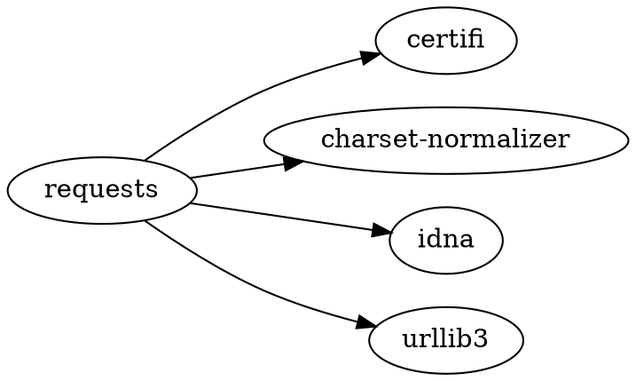
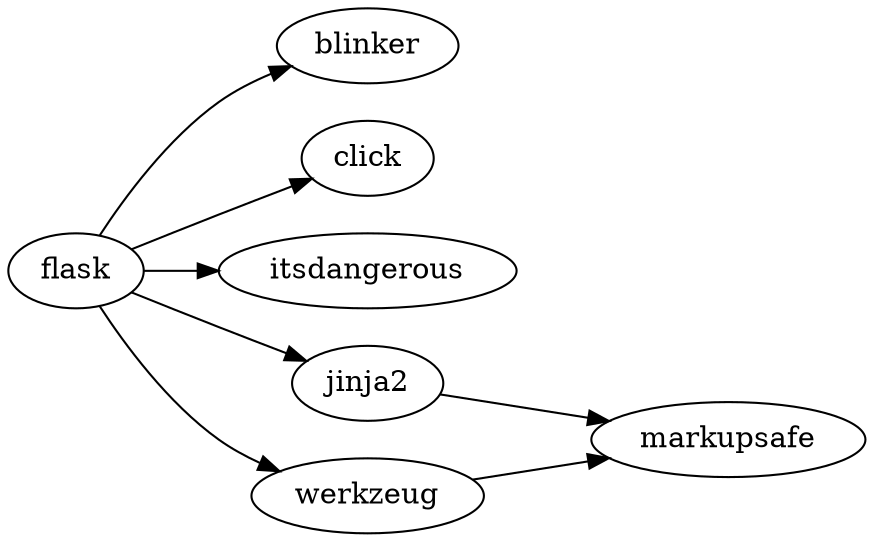

# pip-dependency-graph

Инструмент командной строки для построения и визуализации графа зависимостей
пакетов Python (pip) по данным репозитория PyPI. Практическая работа №2 по
дисциплине «Конфигурационное управление», вариант 29.

Готовые менеджеры пакетов и сторонние библиотеки для получения информации о
зависимостях не используются: метаданные пакетов загружаются напрямую из
репозитория по HTTP и разбираются собственным кодом. Приложение написано
только на стандартной библиотеке Python и работает на Linux, macOS и Windows.

## Возможности

Этап 1:

- загрузка настроек из JSON-файла конфигурации;
- проверка каждого параметра с понятным сообщением об ошибке.

Этап 2:

- получение прямых зависимостей пакета для заданной версии из репозитория
  PyPI (JSON API: `URL/<пакет>/<версия>/json`);
- разбор строк зависимостей `requires_dist` по спецификации PEP 508 с
  обработкой маркеров окружения (`extra`, `python_version`).

Этап 3:

- построение графа зависимостей с учётом транзитивности алгоритмом BFS,
  реализованным через рекурсию;
- корректная обработка циклических зависимостей (каждый пакет раскрывается
  один раз, повторные встречи не приводят к зацикливанию);
- исключение из анализа пакетов, имя которых содержит заданную подстроку
  (`filter`); корневой пакет анализируется всегда;
- режим тестирования: вместо URL репозитория используется файл описания
  графа, пакеты в котором называются большими латинскими буквами.

Этап 4:

- вывод на экран порядка загрузки зависимостей: топологическая сортировка
  графа алгоритмом Кана — каждая зависимость выводится раньше пакета,
  который от неё зависит;
- пакеты, вовлечённые в цикл, не имеют корректного порядка загрузки —
  они выводятся в конце списка в лексикографическом порядке.

Этап 5 (текущий):

- формирование текстового представления графа на языке диаграмм Graphviz
  (DOT) и его вывод на экран — код можно отрисовать утилитой `dot`
  или любым редактором диаграмм;
- при `ascii_tree: true` дополнительный вывод зависимостей ASCII-деревом
  (только символы ASCII — корректный вывод на любой консоли, включая
  Windows); пакет на текущем пути помечается `(cycle)`, уже показанный
  поддерево — `(already listed)`.

## Параметры конфигурации

Источником параметров является JSON-файл (по умолчанию `config.json`).

| Параметр | Тип | Описание |
|---|---|---|
| `package` | строка | имя анализируемого пакета (обязателен, не пустой) |
| `repository` | строка | URL репозитория (http/https); при `test_mode: true` — путь к файлу тестового репозитория |
| `test_mode` | булево | режим работы с тестовым репозиторием, по умолчанию `false` |
| `version` | строка | версия анализируемого пакета (обязательна, формат PEP 440) |
| `ascii_tree` | булево | вывод зависимостей в виде ASCII-дерева, по умолчанию `false` |
| `filter` | строка | подстрока для исключения пакетов из анализа, по умолчанию `""` |

Неизвестные ключи, отсутствующие обязательные ключи, неверные типы,
некорректный URL, отсутствующий файл тестового репозитория и невалидная
версия приводят к понятному сообщению об ошибке и коду выхода 2. Ошибки
репозитория приводят к сообщению и коду выхода 1.

## Функции

Модуль `src/config.py`:

- `load_config(path)` — читает JSON-файл, проверяет все параметры и
  возвращает объект `Config`; при ошибке возбуждает `ConfigError`.

Модуль `src/pypi.py`:

- `build_metadata_url(repository, package, version)` — формирует URL
  метаданных пакета заданной версии в репозитории;
- `fetch_direct_dependencies(repository, package, version)` — возвращает
  список прямых зависимостей заданной версии пакета;
- `fetch_latest_direct_dependencies(repository, package)` — возвращает
  список прямых зависимостей последней версии пакета;
- `pypi_source(repository, root, version)` — возвращает источник данных
  для построения графа: корень — по заданной версии, остальные пакеты —
  по последней версии.

Модуль `src/testrepo.py`:

- `load_test_repository(path)` — возвращает источник данных, читающий
  прямые зависимости из файла тестового репозитория; некорректная строка
  файла возбуждает `RepositoryError` с номером строки.

Модуль `src/graph.py`:

- `build_dependency_graph(source, root, exclude)` — строит граф
  зависимостей алгоритмом BFS с рекурсией; `exclude` — подстрока для
  исключения пакетов из анализа (корень анализируется всегда);
- `load_order(graph)` — возвращает порядок загрузки (топологическая
  сортировка Кана); пакеты из циклов помещаются в конец списка.

Модуль `src/errors.py`:

- `RepositoryError` — тип ошибок репозитория (сеть, HTTP, формат данных,
  файл тестового репозитория).

Модуль `src/dot.py`:

- `to_dot(graph)` — формирует описание графа на языке Graphviz (digraph):
  все узлы объявлены, рёбра идут от пакета к его зависимостям.

Модуль `src/tree.py`:

- `render_tree(graph, root)` — возвращает строки ASCII-дерева зависимостей;
  пакет на текущем пути помечается `(cycle)`, уже показанный — `(already
  listed)`.

## Формат тестового репозитория

Текстовый файл, по одной строке на пакет:

```text
ИМЯ: ЗАВИСИМОСТЬ ЗАВИСИМОСТЬ ...
```

Имена — большие латинские буквы. Пакет без зависимостей записывается как
`ИМЯ:` либо может отсутствовать в файле (считается, что зависимостей нет).
Пустые строки игнорируются. Некорректная строка или имя не из больших
латинских букв — ошибка с номером строки.

Пример (`tests/fixtures/repo.txt`) содержит цикл `B -> D -> E -> B`:

```text
A: B C
B: C D
C: E
D: E
E: B
F: G
H:
```

## Запуск

Linux и macOS:

```bash
./run.sh
./run.sh --config path/to/config.json
```

Windows (cmd):

```bat
run.bat
run.bat --config path\to\config.json
```

## Запуск тестов

```bash
./run.sh test
```

```bat
run.bat test
```

## Примеры

Пакет `requests` 2.32.0 (конфигурация `config.json` по умолчанию) —
описание графа на языке Graphviz выводится всегда:



Тот же пакет с `ascii_tree: true` — сначала ASCII-дерево, затем DOT:

```text
requests
|-- certifi
|-- charset-normalizer
|-- idna
`-- urllib3
```

Пакет `flask` 3.0.0 — транзитивная зависимость `markupsafe` подтягивается
через `jinja2` и `werkzeug`:



Тестовый репозиторий, пакет `A` с циклом `B -> D -> E -> B`,
`ascii_tree: true`:

```text
A
|-- B
|   |-- C
|   |   `-- E
|   |       `-- B (cycle)
|   `-- D
|       `-- E (already listed)
`-- C (already listed)
```

## Сравнение с pip

Для сравнения использован реальный менеджер пакетов pip 26.2.2
(Python 3.14) в режиме пробной установки `--dry-run`.

Команда `pip install --dry-run requests==2.32.0` выводит результат
разрешения зависимостей:

```text
Would install certifi-2026.10.23 charset-normalizer-3.5.2 idna-3.20 requests-2.32.0 urllib3-2.8.0
```

Инструмент для того же пакета строит граф из тех же пакетов (см. раздел
«Примеры»): множества пакетов совпадают — certifi, charset-normalizer,
idna, urllib3 (+ сам requests).

Для `flask==3.0.0` pip сообщает:

```text
Would install Flask-3.0.0 Jinja2-3.1.6 MarkupSafe-3.0.4 Werkzeug-3.1.9 blinker-1.9.0 click-8.5.1 itsdangerous-2.2.0
```

Инструмент строит транзитивный граф из тех же семи пакетов (MarkupSafe
подтягивается транзитивно через Jinja2).

Расхождения и их причины:

- pip выводит не последовательность загрузки, а результат разрешения
  зависимостей — набор пакетов с конкретными версиями, который был бы
  установлен. Порядок установки у pip — внутренняя деталь реализации,
  поэтому сравнивать напрямую можно только множества пакетов, и они
  совпадают.
- pip выбирает версии через разрешение конфликтов (на момент запуска:
  urllib3-2.8.0, certifi-2026.10.23), а инструмент анализирует метаданные
  последних версий транзитивных пакетов. Со временем версии у pip будут
  меняться, набор пакетов — как правило, нет.
- pip оценивает маркеры окружения и уже установленные в системе пакеты;
  инструмент оценивает маркеры только для текущего интерпретатора и не
  учитывает состояние системы, поэтому наборы могут отличаться, если
  часть зависимостей уже установлена.

## Сравнение с pipdeptree

Штатный инструмент визуализации дерева зависимостей для pip —
`pipdeptree` (pip 26.2.2, Python 3.14), запущенный для пакетов,
установленных в изолированное окружение:

```text
$ pipdeptree --packages requests
requests==2.32.0
├── certifi [required: >=2017.4.17, installed: 2026.10.23]
├── charset-normalizer [required: >=2,<4, installed: 3.5.2]
├── idna [required: >=2.5,<4, installed: 3.20]
└── urllib3 [required: >=1.21.1,<3, installed: 2.8.0]
```

```text
$ pipdeptree --packages flask
Flask==3.0.0
├── blinker [required: >=1.6.2, installed: 1.9.0]
├── click [required: >=8.1.3, installed: 8.5.1]
├── itsdangerous [required: >=2.1.2, installed: 2.2.0]
├── Jinja2 [required: >=3.1.2, installed: 3.1.6]
│   └── MarkupSafe [required: >=2.0, installed: 3.0.4]
└── Werkzeug [required: >=3.0.0, installed: 3.1.9]
    └── MarkupSafe [required: >=2.1.1, installed: 3.0.4]
```

Структура совпадает с выводом инструмента: те же пакеты и те же связи,
включая транзитивный `markupsafe` у `flask` (см. примеры выше).

Расхождения и их причины:

- pipdeptree работает с установленными пакетами и показывает версии
  (требуемые и фактические), а инструмент строит граф по метаданным
  репозитория, ничего не устанавливая, и версии не выводит;
- pipdeptree повторяет общие поддеревья (`MarkupSafe` показан дважды — под
  `Jinja2` и под `Werkzeug`), инструмент помечает повторы
  `(already listed)` — информация о связях при этом не теряется и видна
  в DOT-описании;
- pipdeptree рисует ветви символами Unicode (`├──`, `└──`, `│`), а
  инструмент — только ASCII (`|--`, `` `-- ``, `|`), что соответствует
  требованию об ASCII-дереве и гарантирует вывод на любой консоли,
  включая Windows;
- циклические зависимости pipdeptree показывает с предупреждением, а
  инструмент помечает пакет на текущем пути суффиксом `(cycle)`.

## Требования

Python 3.8 и новее. Внешние зависимости отсутствуют. Для работы с реальным
репозиторием требуется доступ в интернет; тесты сетью не пользуются.

## Структура репозитория

```text
config.json               пример конфигурации (запрос к PyPI)
run.sh                    запуск на Linux и macOS
run.bat                   запуск на Windows
src/config.py             загрузка и валидация конфигурации
src/errors.py             тип ошибок репозитория
src/pypi.py               получение и разбор метаданных PyPI
src/testrepo.py           файл тестового репозитория как источник данных
src/graph.py              построение графа зависимостей (BFS с рекурсией)
src/dot.py                представление графа на языке Graphviz
src/tree.py               ASCII-дерево зависимостей
src/main.py               точка входа
tests/test_config.py      тесты конфигурации
tests/test_pypi.py        тесты получения зависимостей
tests/test_graph.py       тесты построения графа
tests/test_order.py       тесты порядка загрузки
tests/test_dot.py         тесты представления Graphviz
tests/test_tree.py        тесты ASCII-дерева
tests/test_testrepo.py    тесты тестового репозитория
tests/fixtures/repo.txt   пример тестового репозитория (с циклом)
```
